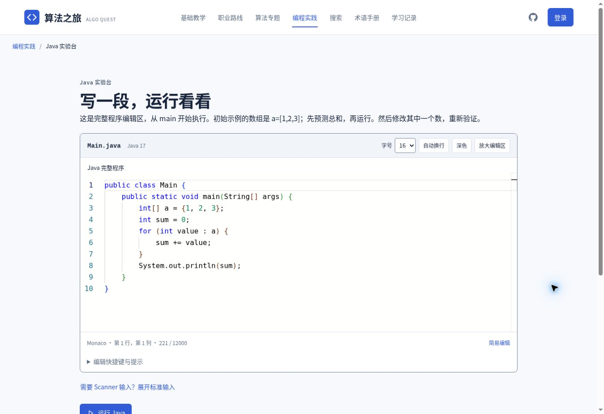

# Monaco Java 编辑器替换说明

日期：2026-11-09。基于已合并课程与 Java 实践的 `main`（`657780c`），本轮直接在主分支开发。

## 替换结果

练习题的方法体、课程示例改写、Java 在线实验台三个入口统一使用 `JavaCodeEditor.vue`。保留原来的 `body` / `source` 草稿字段、存储键、账号隔离、提示记录、示例运行和全部测试，不会因为换编辑器清空已有代码。

| 能力 | 实现 |
| --- | --- |
| 编辑 | Monaco Editor 0.57.0，Java 高亮、行号、缩进、自动闭合、括号匹配、代码折叠、查找、注释和撤销 |
| 常用补全 | `fori` / `foreach` / `sout` 片段，关键字说明，当前源码与方法参数中常见声明的变量提示；数组、字符串、集合及常用静态 API 的有限成员提示 |
| 悬停与参数 | Java 基础关键字的通俗解释，println / print / Math.max / Math.min / Arrays.sort 的常用参数提示 |
| 显示 | 14/16/18/20px 字号、浅/深色、换行开关、编辑区放大、行列状态 |
| 快捷运行 | Ctrl/⌘ + Enter；练习题运行示例，完整程序运行当前 Main.java。提交全部测试仍使用明确的提交按钮 |
| 编译错误 | 使用真实 javac 诊断，按程序框架偏移映射到编辑区红线，点击错误回到相应行；修改代码后清空旧标记，过期运行的结果不写入当前编辑器 |
| 小屏与兼容 | 手机默认简易编辑，可主动切换 Monaco，两种模式共享同一草稿。加载失败时保留可编辑文本及重试。file:// 离线文件保留简易编辑 |
| 生命周期 | 编辑器进入可见区域才加载；卸载时销毁模型、编辑器、观察器和监听；开发热更新注销旧补全/悬停/参数提供器 |

## 编辑器和运行时的边界

Monaco 负责代码编辑，不是 Java 编译器。运行与判题继续使用本站已有的 CheerpJ / JDK 17 隔离环境、真实测试和超时保护。代码没有转发给力扣服务器，也没有新增后端代码执行服务或 Supabase 迁移。

Java 的基础高亮与本站常用提示不等同于完整 Java LSP 语义分析。当前不会伪造逐键类型诊断；编译错误在运行/提交后由真正的 Java 编译器提供。复杂类型推断、跨文件引用查找、自动导入等完整 IDE 能力未在本轮声称实现。

Monaco 官方不把移动浏览器或 file:// 工作线程列为受支持环境，因此保留简易模式作为兼容入口。用户仍可在手机浏览器尝试专业编辑；这不改变判题逻辑。

## 维护入口

| 文件 | 责任 |
| --- | --- |
| `src/components/JavaCodeEditor.vue` | Vue 模型同步、延迟加载、显示工具、降级、快捷键、标记与定位、销毁 |
| `src/java/monaco-java.js` | Monaco ESM、Java 高亮、Vite Worker、功能注册及常用提供器 |
| `src/java/editor-support.js` | 可单独检查的有限提示规则与编译行号转换，避免将启发式提示当作编译结论 |
| `src/components/JavaCodingTask.vue` | 方法体编辑及框架行号偏移，保留原任务/进度机制 |
| `src/components/RunnableJava.vue` | 完整示例改写，保留原草稿 |
| `src/pages/JavaPlayground.vue` | 完整程序、标准输入与运行 |
| `src/components/JavaRunPanel.vue` | 真实诊断事件、点击定位与过期结果拦截 |
| `src/java-editor.css` | 编辑区样式与小屏布局，隔离全站 textarea 样式对 Monaco 输入层的影响，继续使用全局圆角变量 |
| `src/useCourseNavigation.js` | 在代码区书写时不抢占编辑器快捷键 |
| `tests/components/java-editor.test.js` | 声明/成员提示、注释过滤、片段、诊断范围与过期结果 |
| `tests/browser/java-editor.spec.js` | 真实 Monaco 高亮、补全、撤销、保存、真实编译红线、手机切换及首页按需加载 |

## 验证

本机格式检查、静态检查、Vite 正式构建、可选旧离线构建和 28 项组件测试已通过。新增浏览器用例与原有流程合计 42 个场景；主分支 CI 的最终结果应全部通过后再发布。

实际浏览器已验证：数组 `a.` 可补全 `length`；Ctrl + Enter 启动真实编译；未声明 `unknownVariable` 产生红线，点击错误将光标定位到第 3 行；修正为数组累计示例后输出 `6`。



## 性能与发布

首页所需 JavaScript gzip 约 147.4 KB，替换前约 147.35 KB；首页不请求 Monaco 或编辑器 Worker。专业编辑首次打开额外加载约 879 KB gzip 的 Monaco Java 代码、约 24 KB gzip 样式、Worker 与字体，并由浏览器缓存。这里只记录构建体积，没有将它冒充实际网络耗时或性能评分。

标准发布仍提供完整 Vite 构建。GitHub Pages 改为等待主分支完整校验工作流成功，再检出并发布同一提交，避免先发布再发现编辑器回归。没有继续创建功能分支。

本机预览：

```powershell
git switch main
git pull --ff-only
npm.cmd ci
npm.cmd run build
npm.cmd run preview -- --port 4173
```

打开 http://127.0.0.1:4173/#/playground 。请在 Git 克隆目录中执行。

参考：[Monaco 官方 README](https://github.com/microsoft/monaco-editor/blob/main/README.md)、[Vite ESM 接入](https://github.com/microsoft/monaco-editor/blob/main/docs/integrate-esm.md)。第三方许可保留于 `THIRD_PARTY_NOTICES.md`。
